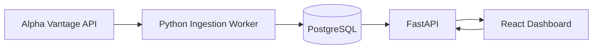

# Quantitative Market Analysis

I developed Quantitative Market Analysis, a full-stack application for exploring historical stock market behavior and identifying unusual activity. It combines financial analytics with statistical anomaly detection and exploratory machine learning to put price and volume movements in historical context. The application uses PostgreSQL, Python, and React to turn daily market data into interactive analysis—not forecasts.

### Dashboard Overview


*Interactive dashboard featuring company selection, ticker search, and on-demand market data analysis.*

## Quantitative Analysis and Why It Matters

The analysis compares each daily observation with prior trading sessions. These complementary views help distinguish a large movement from one that is unusual for the stock, assess trading activity around it, and explore combinations of indicators without implying future performance.

### Statistical Anomaly Detection

A **Rolling Z-Score** measures a daily return relative to the stock's mean return and standard deviation over the preceding **60 trading sessions**. Because stocks have different typical levels of fluctuation, this standardization helps show whether a move is unusual for that stock rather than merely large in absolute terms; observations with **|Z| ≥ 2.5** are flagged.

**Relative Volume** compares the session's trading volume with the average of the preceding **20 trading sessions**, flagging ratios of **2.5× or higher**. It adds participation context to the return signal: a large move with unusually high volume differs from one on ordinary volume, but high volume does not confirm a move's direction or future continuation.


*Rolling Z-Score, Relative Volume, and Local Outlier Factor detectors, alongside a historical Z-Score timeline highlighting unusual stock returns.*

### Trading Volume and Volatility

Relative volume provides a historical baseline for judging whether trading activity was elevated during a session. The dashboard also plots the **20-session sample standard deviation of daily returns** against its prior **60-session mean**; this helps put changing levels of fluctuation in context. Volatility measures variability, not the direction of future returns.


*Relative trading volume compared against a 20-session historical baseline, alongside rolling volatility calculated from daily returns.*

### Return Distribution and Volume Relationships

The return histogram shows how often different daily returns occurred, making the tails of the observed distribution easier to inspect against more common movements. The return-versus-volume scatter plot shows whether larger moves coincided with unusual trading activity. These are exploratory views, not separate forecasting algorithms.


*Daily returns plotted against relative trading volume, alongside an empirical distribution of historical returns.*

### Machine Learning — Local Outlier Factor

**Local Outlier Factor (LOF)** uses scikit-learn to identify sessions whose combination of **daily return, relative volume, and intraday price range** differs from nearby observations. A return or volume value may look ordinary by itself while the combination is unusual, giving LOF a multivariate perspective alongside the individual statistical indicators. The model trains on earlier observations and evaluates subsequent ones to avoid future-data leakage; its novelty scores and feature projections are exploratory, not forecasts.


*LOF novelty scores and a two-dimensional feature projection highlighting observations identified as unusual by the model.*

### Market Data Dashboard

The Market Data dashboard brings historical prices and moving averages together with daily and period returns, volatility, stock rankings, and anomaly classifications. This lets users evaluate an alert in the context of a stock's broader price history rather than interpreting an isolated score.


*Airbnb (ABNB) market analysis featuring historical closing prices, financial indicators, stock performance rankings, and detected anomalies.*

## Results

### Database Performance

The optimized stock-ranking query reduced median execution time in a local PostgreSQL benchmark:

| Local benchmark metric | Original query | Optimized query |
|---|---:|---:|
| Median execution time | 33.389 ms | 3.861 ms |
| Execution time reduction | — | **88.44%** |
| Dataset | 1,000,300 price records across 203 tickers | 1,000,300 price records across 203 tickers |

These are measurements from the local benchmark workload, not universal performance guarantees.

### Statistical Anomaly Detection

On **September 23, 2026**, Airbnb (ABNB) recorded a **−7.56%** daily return, a Rolling Z-Score of **−2.61**, and Relative Volume of **3.06×**. Both statistical detectors triggered, producing a high-severity classification: the alert combines an unusually large move relative to prior returns with unusually high trading activity. It identifies observed historical behavior; it does not predict the event.

### Machine Learning Analysis

LOF adds an exploratory multivariate view of unusual sessions using return, volume, and intraday range. The dashboard exposes novelty scores and feature projections; no predictive-accuracy claim is made.

### Full-Stack Integration

The completed application combines on-demand historical data ingestion, PostgreSQL-backed analytics, statistical and LOF analysis, REST endpoints with FastAPI, interactive React visualizations, and Docker Compose deployment.

## SQL Analytics and Database Optimization

PostgreSQL stores historical open, high, low, close, and volume (OHLCV) observations. SQL queries use `LAG()` for daily returns, window functions for moving averages, and `STDDEV_SAMP()` for sample volatility; common table expressions (CTEs) organize period-return calculations and stock rankings. The queries are available in [`database/queries.sql`](./database/queries.sql).

The schema uses primary keys, constraints, and ticker/date indexes to maintain data integrity and support historical lookups. For the ranking optimization, the query rewrite uses bounded first/last-close lookups and ranks the resulting returns. PostgreSQL `EXPLAIN (ANALYZE, BUFFERS)` plans were used to compare the original and rewritten queries; benchmark results are summarized above and detailed in the [Database Benchmark Report](./database/benchmark_results.md).

The benchmark dataset contains 1,000,000 deterministic synthetic price records plus 300 imported records across 203 tickers. Synthetic records are labeled separately from real market data and excluded from anomaly analysis. The covering-index experiment was not retained; the measured performance improvement is attributed to the query rewrite.

## Architecture and Tech Stack



Python workers retrieve and validate daily OHLCV data from Alpha Vantage and store it in PostgreSQL. FastAPI serves market data and analysis to the React dashboard; Docker Compose runs the application services.

| Area | Technologies |
|---|---|
| Frontend | React, JavaScript, Vite, Recharts |
| Backend | Python, FastAPI |
| Database | PostgreSQL 16, SQLAlchemy, psycopg |
| Machine learning | scikit-learn |
| Data source | Alpha Vantage API |
| Infrastructure | Docker, Docker Compose, Nginx |
| Testing | pytest, JavaScript automated tests |

## Additional Technical Details

- **Data operations:** On-demand ingestion and automated refresh check for newly available daily market data; Alpha Vantage free-tier limits can restrict coverage and request frequency.
- **API:** FastAPI's interactive documentation is available at `http://localhost:8000/docs` when running locally. Endpoints cover stocks, search and directory, indicators, anomalies, models, ingestion jobs, and market refresh.
- **Testing:** Backend tests run with `.venv/bin/python -m pytest -q`. From `frontend/`, run `npm test`, `npm run build`, and `npm run lint`. Some backend integration tests require PostgreSQL with historical market data.
- **Project structure:**

  ```text
  quantitative-market-analysis/
  ├── backend/             # FastAPI, ingestion, anomaly detection
  ├── frontend/            # React dashboard and visualizations
  ├── database/            # SQL queries, schema, migrations, benchmarks
  ├── scripts/             # Ingestion and benchmarking utilities
  ├── tests/               # Backend automated tests
  ├── docker-compose.yml
  └── README.md
  ```

---

Developed by **Shaurya Shrivastava**
