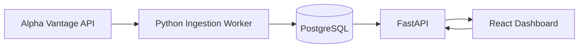

# Quantitative Market Analysis

I developed Quantitative Market Analysis, a full-stack application for exploring historical stock market behavior through financial analytics, statistical anomaly detection, and machine learning. PostgreSQL and SQL power the analysis of historical market data, while a Python backend and React dashboard deliver anomaly results and interactive visualizations. The application also supports on-demand stock data ingestion, automated market data updates, and query optimization for large datasets.

### Dashboard Overview


*Interactive dashboard featuring company selection, ticker search, and on-demand market data analysis.*

## Features

- **Financial Analytics:** Calculate stock returns, moving averages, volatility, and performance rankings using PostgreSQL queries.
- **Anomaly Detection:** Identify unusual price movements and trading activity using Rolling Z-Score, Relative Volume, and Local Outlier Factor (LOF).
- **Interactive Dashboard:** Explore historical stock prices, statistical indicators, and detected anomalies through interactive charts.
- **Dynamic Stock Analysis:** Search for publicly traded companies and retrieve historical market data on demand through Alpha Vantage.
- **Automated Data Refresh:** Check for newly available trading-day data and update existing analyses.
- **Database Optimization:** Benchmark SQL queries against over one million records and improve execution performance through query optimization and indexing.
- **Containerized Deployment:** Run the complete application using Docker Compose.

## Tech Stack

| Component | Technologies |
|---|---|
| Frontend | React, JavaScript, Vite, Recharts |
| Backend | Python, FastAPI |
| Database | PostgreSQL 16, SQLAlchemy, psycopg |
| Machine Learning | scikit-learn |
| Data Source | Alpha Vantage API |
| Infrastructure | Docker, Docker Compose, Nginx |
| Testing | pytest, JavaScript automated tests |

## Architecture



The application uses a containerized architecture with separate services for data ingestion, database management, backend processing, and frontend visualization.

- **Data Ingestion:** Python workers retrieve and validate daily OHLCV data from Alpha Vantage.
- **Database:** PostgreSQL stores historical prices, financial indicators, anomaly results, and ingestion metadata.
- **Backend:** FastAPI exposes market data and statistical analysis through REST endpoints.
- **Frontend:** React and Recharts provide interactive visualizations.
- **Infrastructure:** Docker Compose manages the application services.

## SQL Analytics and Database Optimization

Historical OHLCV market data is stored in PostgreSQL, which supports the application's financial calculations, historical data management, and analytical queries.

### Financial Analytics

The project uses SQL to implement:

- **Daily Returns:** Calculate percentage changes between consecutive closing prices using `LAG()`.
- **Moving Averages:** Compute rolling averages using SQL window functions.
- **Volatility:** Measure the sample standard deviation of daily returns using `STDDEV_SAMP()`.
- **Stock Rankings:** Compare stock performance across selected date ranges using common table expressions (CTEs).
- **Historical Queries:** Retrieve and filter price observations using indexed ticker and date columns.

These queries are available in [`database/queries.sql`](./database/queries.sql). The implementation uses SQL window functions, common table expressions (CTEs), and indexes to calculate and retrieve financial metrics efficiently.

### Database Design

The relational database manages:

- Company information and ticker symbols.
- Historical open, high, low, close, and volume (OHLCV) records.
- Statistical indicators and anomaly detection results.
- Versioned model runs and classifications.
- Background ingestion jobs and refresh metadata.

Primary keys and database constraints maintain data integrity and prevent duplicate daily price observations.

### Performance Benchmarking

To evaluate database performance at scale, the project includes a reproducible SQL benchmarking workflow.

- Generated **1,000,000 synthetic price records** for performance testing.
- Benchmarked analytical queries against **1,000,300 records across 203 tickers**.
- Used PostgreSQL's `EXPLAIN (ANALYZE, BUFFERS)` to examine execution plans.
- Optimized a stock performance ranking query through SQL restructuring and indexing.
- Verified that the optimized query returned identical results.

| Local benchmark metric | Original query | Optimized query |
|---|---:|---:|
| Median execution time | 33.389 ms | 3.861 ms |
| Execution time reduction | — | **88.44%** |
| Dataset | 1,000,300 records, 203 tickers | 1,000,300 records, 203 tickers |

These results reflect a local PostgreSQL benchmark workload, not a universal performance guarantee. Synthetic benchmark records are kept separate from real market data and are excluded from anomaly analysis.

See the [Database Benchmark Report](./database/benchmark_results.md) for methodology and detailed results.

## Quantitative Anomaly Detection

The application implements three complementary methods for identifying unusual stock market activity.

### 1. Rolling Z-Score

Measures how significantly a stock's daily return deviates from its recent historical behavior.

- Uses the preceding **60 trading days** to calculate the mean and standard deviation.
- Standardizes each daily return relative to its historical baseline.
- Flags observations where **|Z| ≥ 2.5**.

### 2. Relative Volume

Identifies unusually high trading activity compared with recent volume.

- Compares current volume against the average of the preceding **20 trading days**.
- Calculates the ratio between current and average historical volume.
- Flags observations where **relative volume ≥ 2.5×**.

### 3. Local Outlier Factor (LOF)

Uses machine learning to identify unusual combinations of market indicators.

- Analyzes daily returns, relative volume, and intraday price range.
- Uses scikit-learn for novelty-based anomaly scoring.
- Trains on earlier observations and scores subsequent observations to avoid future-data leakage.
- Provides an exploratory multivariate perspective alongside the statistical methods.

The dashboard also visualizes **20-day rolling volatility** to provide additional context for market behavior.

These methods identify statistical outliers rather than predict future stock prices.

### Quantitative Analysis Visualizations

#### Statistical Anomaly Detection


*Rolling Z-Score, Relative Volume, and Local Outlier Factor detectors, alongside a historical Z-Score timeline highlighting unusual stock returns.*

#### Trading Volume and Volatility


*Relative trading volume compared against a 20-session historical baseline, alongside rolling volatility calculated from daily returns.*

#### Return Distribution and Volume Relationships


*Daily returns plotted against relative trading volume, alongside an empirical distribution of historical returns.*

#### Machine Learning — Local Outlier Factor


*LOF novelty scores and a two-dimensional feature projection highlighting observations identified as unusual by the model.*

LOF evaluates unusual combinations of daily returns, relative volume, and intraday price range. It is an exploratory anomaly-detection method, not a forecasting model.

## Dashboard

The application includes three main sections:

- **Anomaly Explorer:** Examine statistical anomalies through interactive charts, model scores, and historical comparisons.
- **Market Data:** Explore stock prices, returns, volatility, and anomaly rankings.
- **Company Directory:** Browse 100 curated companies or search for additional publicly traded stocks.

Users can select previously loaded companies or retrieve historical data for new tickers directly from the dashboard.

### Market Data Dashboard


*Airbnb (ABNB) market analysis featuring historical closing prices, financial indicators, stock performance rankings, and detected anomalies.*

For example, on September 23, 2026, ABNB's −7.56% daily return had a Rolling Z-Score of −2.61 and Relative Volume of 3.06×; both detectors flagged it as high severity.

## Getting Started

### Prerequisites

- Docker and Docker Compose
- An Alpha Vantage API key

### Installation

**1. Clone the repository**

```bash
git clone https://github.com/Shaurya0507/stock-market-analysis.git
cd stock-market-analysis
```

**2. Configure environment variables**

```bash
cp .env.example .env
```

Add your Alpha Vantage API key to the `.env` file.

**3. Start the application**

```bash
docker compose up --build
```

**4. Open the dashboard**

- **Frontend:** `http://localhost:5173`
- **API Documentation:** `http://localhost:8000/docs`

Select a company or search by ticker symbol. If historical data is unavailable, click **Load Historical Data** to retrieve and analyze it.

### Stopping the Application

```bash
docker compose down
```

The PostgreSQL Docker volume persists between runs unless explicitly removed.

**Note:** Alpha Vantage's free-tier API limits may restrict historical coverage and the frequency of new data requests.

## Project Structure

```text
stock-market-analysis/
├── backend/             # FastAPI, ingestion, anomaly detection
├── frontend/            # React dashboard and visualizations
├── database/            # SQL queries, schema, migrations, benchmarks
├── scripts/             # Ingestion and benchmarking utilities
├── tests/               # Backend automated tests
├── docker-compose.yml
└── README.md
```

## Testing

**Backend tests**

```bash
.venv/bin/python -m pytest -q
```

Some integration tests require a running PostgreSQL instance and populated historical market data.

**Frontend tests and validation**

```bash
cd frontend
npm test
npm run build
npm run lint
```

---

Developed by **Shaurya Shrivastava**