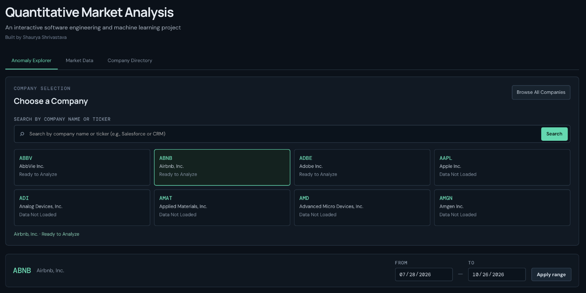
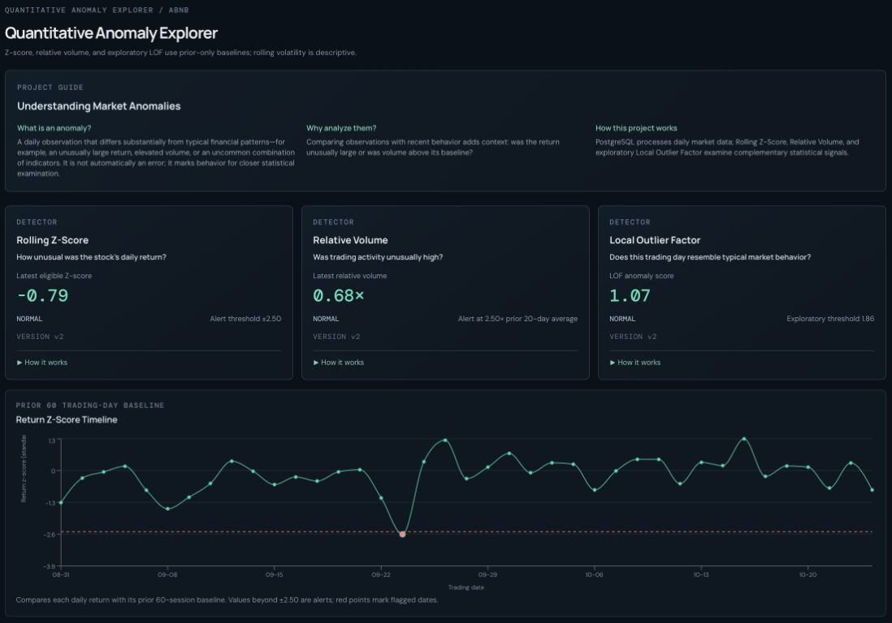
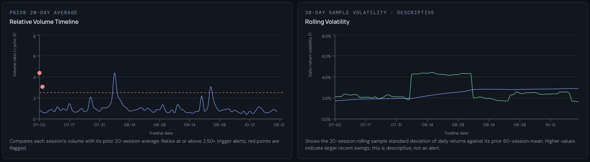
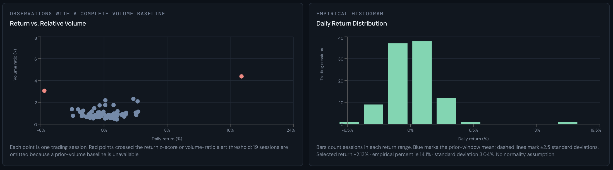
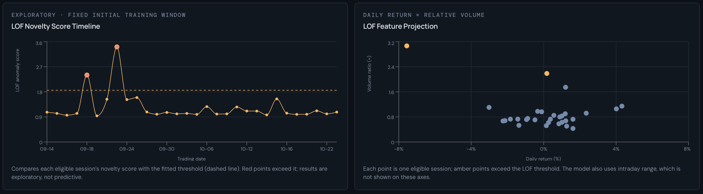
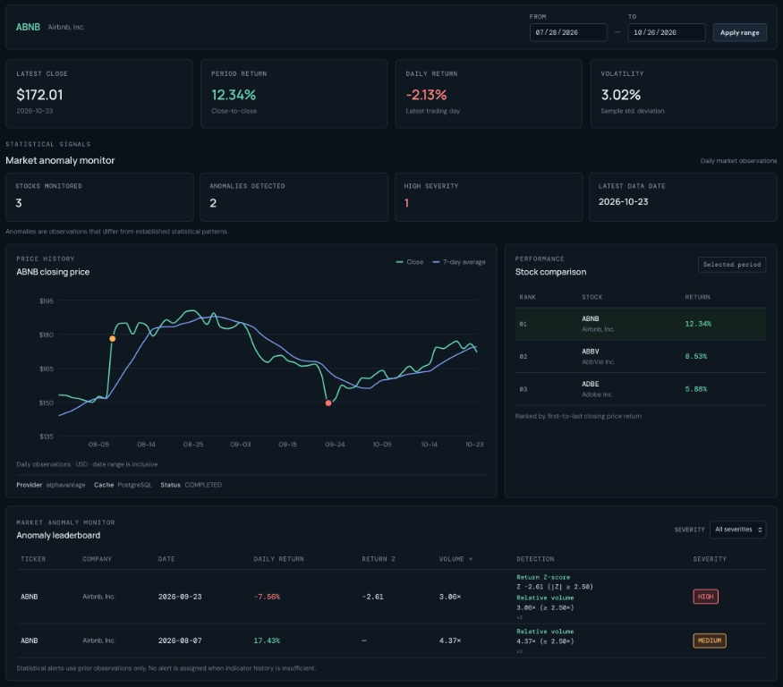

# Quantitative Market Analysis

I developed Quantitative Market Analysis, a full-stack application for exploring historical stock market behavior and identifying unusual activity. It combines financial analytics with statistical anomaly detection and exploratory machine learning to put price and volume movements in context. The application uses PostgreSQL, Python, and React to turn daily market data into interactive analysis—not forecasts.

## Architecture and Tech Stack

**Alpha Vantage → Python ingestion → PostgreSQL → FastAPI → React dashboard**

The ingestion worker retrieves and validates daily OHLCV data before storing it in PostgreSQL. FastAPI serves the market data and analysis to the dashboard, and the React client also calls the API directly. Docker Compose runs the application services.

| Area | Technologies |
|---|---|
| Frontend | React, JavaScript, Vite, Recharts |
| Backend | Python, FastAPI |
| Database | PostgreSQL 16, SQLAlchemy, psycopg |
| Machine learning | scikit-learn |
| Data source | Alpha Vantage API |
| Infrastructure | Docker, Docker Compose, Nginx |
| Testing | pytest, JavaScript automated tests |

## API

FastAPI provides endpoints for stock data, search and company directory, financial indicators, anomalies, model results, ingestion jobs, and market refresh. When running locally, interactive API documentation is available at `http://localhost:8000/docs`.

## Project Structure

```text
quantitative-market-analysis/
├── backend/             # FastAPI, ingestion, anomaly detection
├── frontend/            # React dashboard and visualizations
├── database/            # SQL queries, schema, migrations, benchmarks
├── scripts/             # Ingestion and benchmarking utilities
├── tests/               # Backend automated tests
├── docker-compose.yml
└── README.md
```

## Dashboard Overview



*Interactive dashboard featuring company selection, ticker search, and on-demand market data analysis.*

## Quantitative Analysis

### Statistical Anomaly Detection

A **Rolling Z-Score** measures a daily return against the stock's mean return and standard deviation over the preceding **60 trading sessions**. Since stocks have different typical levels of fluctuation, this helps distinguish an unusual move for a particular stock from one that is simply large in absolute terms. Observations with **|Z| ≥ 2.5** are flagged.

**Relative Volume** compares a session's trading volume with the average of the preceding **20 trading sessions** and flags ratios of **2.5× or higher**. It adds participation context to price movements: a large move on unusually high volume differs from one on ordinary volume, though high volume does not confirm the move's direction or future continuation.



*Rolling Z-Score, Relative Volume, and Local Outlier Factor detectors, alongside a historical Z-Score timeline highlighting unusual stock returns.*

### Trading Volume and Volatility

Relative volume shows whether trading activity was elevated compared with its recent baseline. The dashboard also plots the **20-session sample standard deviation of daily returns** against its prior **60-session mean**, helping put changes in price variability in context. Volatility measures variability, not the direction of future returns.



*Relative trading volume compared against a 20-session historical baseline, alongside rolling volatility calculated from daily returns.*

### Return Distribution and Volume Relationships

The return histogram shows how often different daily returns occurred, making the distribution's tails easier to compare with more common movements. The return-versus-volume scatter plot shows whether larger moves coincided with unusual trading activity. These are exploratory visualizations, not forecasting algorithms.



*Daily returns plotted against relative trading volume, alongside an empirical distribution of historical returns.*

### Machine Learning — Local Outlier Factor

**Local Outlier Factor (LOF)** is an unsupervised machine learning algorithm implemented with scikit-learn. It identifies sessions whose combination of **daily return, relative volume, and intraday price range** differs from nearby observations. A return or volume value may look ordinary by itself while the combination is unusual, giving LOF a multivariate view alongside the individual indicators. The model trains on earlier observations and evaluates subsequent ones to avoid future-data leakage; its novelty scores and feature projections are exploratory, not forecasts.



*LOF novelty scores and a two-dimensional feature projection highlighting observations identified as unusual by the model.*

## Market Data Dashboard

The Market Data dashboard brings historical prices and moving averages together with daily and period returns, volatility, performance rankings, and anomaly classifications. This helps users consider an alert alongside broader price behavior rather than interpreting an isolated score.



*Market analysis dashboard featuring historical closing prices, financial indicators, stock performance rankings, and detected anomalies.*

## SQL Analytics and Database Optimization

PostgreSQL stores historical open, high, low, close, and volume (OHLCV) observations. SQL uses `LAG()` for daily returns, window functions for moving averages, and `STDDEV_SAMP()` for sample volatility; common table expressions (CTEs) organize period-return calculations and performance rankings.

Primary keys, database constraints, and ticker/date indexes maintain data integrity and support historical lookups. For the ranking query, a rewrite uses bounded first- and last-close lookups before ranking returns. PostgreSQL `EXPLAIN (ANALYZE, BUFFERS)` plans were used to compare the query versions. Synthetic benchmark records are kept separate from real market data and excluded from anomaly analysis; a covering-index experiment was evaluated but not retained.

## Results

### Database Performance

In a local PostgreSQL benchmark, the optimized stock-ranking query reduced median execution time by **88.44%** across **1,000,300 price records and 203 tickers**. These measurements describe the local benchmark workload, not a universal performance guarantee.

| Local benchmark metric | Original query | Optimized query |
|---|---:|---:|
| Median execution time | 33.389 ms | 3.861 ms |
| Execution time reduction | — | **88.44%** |
| Dataset | 1,000,300 price records across 203 tickers | 1,000,300 price records across 203 tickers |
